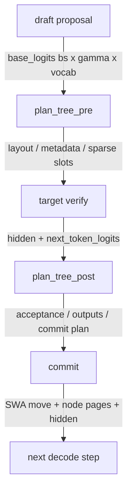

# DSV4 + DSpark 树形投机解码：从 topk=1 到 topk>1 的设计与改动说明

> **分支**：`feat/npu-dsv4-dspark-tree-v5`  
> **基线**：`main = 5d4a6f499e`  
> **检视 commit**：`6a7d2a2b4d`（2026-11-02 复核）
> **作者**：`unclezhou486`  
> **范围**：4 个 commit，17 个文件，+3832 / −84；生产 2,790 行（净增 2,706），测试 1,042 行（66 个 CPU 用例）。
>
> **读者**：熟悉 DSpark 基本概念、但不熟 DSV4 内部状态和树算子的工程师。  
> **用途**：设计评审与检视 onboarding，不是逐行教程，也不替代 `npu-dspark-tree-explained.zh.md` 的从零讲解。
>
> **状态标记**：
> - 【已验证】CPU 66/66 通过；
> - 【设计意图】代码已写、硬件未验证；
> - 【未验证】A3/V2、backend 运行时、TP/DP、性能；
> - 【据文档】来自现有设计文档，未独立核对参考实现代码。

---

## 0. TL;DR

链式 DSpark（topk=1）每次只验证一条候选链；树式 DSpark（topk>1）在同一个已提交 prefix 上展开多条分支，让 target 一次验证 `1+budget` 行。两者的差别不只是“多几行”，而是：

1. **同一个 position 上可以有多个节点**，position 不再是 KV 的唯一 key；
2. **压缩 KV 的内容是分支相关的**，同一个 c4/c128 块在不同分支上内容不同；
3. 因此 attention 必须按 **node id / 祖先链**寻址，压缩必须按节点生成，commit 只能写 winner 路径。

四个树算子、节点页提交、以及 worker/backend 的接线，都是为这三件事服务。

| 维度 | topk=1 | topk>1 |
|---|---|---|
| draft | 一条链 | 同一份逐深度 logits 展开成树 |
| 规划 | 无 | layout + metadata + sparse slots |
| verify 行数 | `gamma+1` | `1+budget` |
| KV 寻址 | position 唯一 | 同 position 多节点，靠 ancestors |
| 压缩 | 每请求一份线性 state | 每节点一份压缩 KV |
| accept | 扁平前缀 | 沿孩子链表走 |
| commit | 前缀门 | SWA 搬移 + 节点页提交 + hidden 重排 |
| 成本 | `gamma+1` 行 | `1+budget` 行，收益需实测 |

---

## 1. topk=1 与 topk>1 的整体区别

### 1.0 先认识这些词

后面会反复出现这些词，先给一张读前地图。附录 B 是速查，这里只解释“在本分支里指什么”。

#### 核心数据概念

| 术语 | 一句话解释 | 在本分支里指什么 |
|---|---|---|
| `prefix` | 已提交历史长度 | 本轮 verify 的起点 |
| `base_logits` | draft 的逐深度 logits | `[bs, gamma, vocab]`，树在此展开 |
| `layout` | 树拓扑 | tokens/depths/parents/孩子链表 |
| `metadata` | 每行几何 | position/ancestors/seqused/cu_seqlens |
| `target_predict` | target 每行 argmax | `[bs, 1+budget]`，accept 用它走树 |
| `bonus` | 接受路径末端多预测的 token | 来自 endpoint 的 target argmax |
| `depth` / `gamma` | draft 深度 | 最多猜几步，也是树的最大接受长度 |
| `topk` | 每个 parent 的孩子数 | level-wise builder 的局部分支因子 |
| `budget` | 非根节点总数 | 最终 verify 宽度是 `1+budget` |
| `width` | 每层实际保留数 | `min(topk, vocab, budget)` |
| `capacity` | builder 物化上限 | `width*depth`，不是 `topk^depth` |
| `verify_width` | 每请求 verify 行数 | 树 `1+budget`，链 `gamma+1` |
| `node id` | 树节点编号 | root=0，非根 1..N；不是 KV slot |
| `position` | 逻辑位置 | `prefix+depth`；同 position 可对应多个节点 |
| `slot` | 物理 KV 槽 | 由 block table 或 verify 窗口给出 |
| `block_size=1` | 一个 token 一行 | commit/compressor 按绝对 position 索引 |
| `full absolute table` | 按绝对 position 索引的页表 | 不是 sliding-window 相对表 |
| verify window | 本轮 target 写的行 | 每请求 `1+budget` 行，每行一个物理 slot |
| `ragged verify` | 变长 verify | 树固定 `1+budget` 行/请求 |
| `tree_prefix` | 已提交历史起点 | 同一请求内所有节点相同 |
| `tree_ancestors` | 祖先链 | root-first；attention 用它选节点 |
| `ori_sparse_indices` | raw KV 可见 slot | 窗口 + 祖先，128 对齐 |
| `cmp_sparse_indices` | 压缩块 top-k | indexer 产出 |
| `cmp_tree_kv` | node pool 里的压缩 KV | 树注意力输入 |
| `seqused_kv` | 每行可见 KV 长度 | `position+1` |
| `cu_seqlens` | 分段前缀和 | kernel 用来切分 query/KV |
| `state`（ratio=1） | 未完成压缩块的状态 | 每个节点一份，供下一轮补齐 |
| `c4` / `c128` | 压缩 KV 池 | ratio 4 / 128 |
| `c4 ring` | c4 state 的循环 buffer | 本轮 verify 写窗口尾部 |
| `SWA` | 滑动窗口 raw KV | 最近窗口的原始 KV |
| `indexer` | 选压缩块 | lightning indexer |

#### 流程与实现术语

| 术语 | 一句话解释 | 在本分支里指什么 |
|---|---|---|
| `winner` | 接受 endpoint | freeze 只提交它的祖先路径 |
| `accept_index` | 接受节点的扁平行下标 | `row * query_width + node` |
| `commit_lens` | root + 接受节点数 | `num_accepted + 1` |
| `new_seq_lens` | 提交后的历史长度 | `prefix + commit_lens` |
| `NodePlan` | 扁平节点几何 | ancestors / start / depths / req / cu |
| `tree_plan` / `TreePrePlan` | 本轮树的完整计划 | layout + metadata + sparse + node pool |
| `TreePostPlan` | 接受后的计划 | acceptance + outputs + commit plan |
| `acceptance` | accept 的结果 | path / num_accepted / endpoint / bonus |
| `commit_hidden` | 写回 target hidden | 按 accept_index 重排到 dest 列 |
| `prepare_nodes` / `commit_nodes` | 节点页提交封装 | freeze + commit |
| `node K/scale` | 当前块压缩 K 及其量化 scale | indexer 用 |
| `NodeRecord` | 一层提交记录 | buffer + node rows + table + pages + ratio |
| `descriptor` | 节点页提交的 host 描述符 | `data_ptr` + stride + row bytes |
| `staging` | 提交暂存区 | freeze 写、commit 读 |
| `freeze` | 选行并暂存 | 不碰 live page |
| `commit` | 写回 live page | 一次性写 staging |

#### 环境与验证术语

| 术语 | 一句话解释 |
|---|---|
| `V1` | accept 后用 chain compressor 复算的等价性实验；当前未启用 |
| `V2` | 四个树算子对 CPU oracle 的一致性验证；当前未跑 |
| `A3` | Ascend A3 机器；硬件关卡在这里执行 |
| `arch35` / `A5` | 新架构；参考实现不支持 |
| `TP16` / `DP16` | 参考实现验证过的并行拓扑【据文档】 |
| `attn_tp` | attention 的 TP 度；树要求为 1 |
| `static ragged` | 固定宽度的 ragged verify；树只支持这个 |
| `folded proposal` | 图折叠的 draft proposal；不保留 `base_logits` |
| `grammar` / `watermark` | 约束解码 / 水印；树显式拒绝 |

### 1.1 一次 decode step 的五阶段对比

| 阶段 | topk=1（链式） | topk>1（树式） |
|---|---|---|
| draft proposal | 一条链，产出 `gamma` 个 token | 同一份 `base_logits [bs, gamma, vocab]`，不增加 draft forward |
| plan | 无 | `plan_tree_pre`：拓扑、metadata、sparse slots |
| target verify | `[anchor, d1..dγ]`，连续前缀 | `[root, n1..nN]`，每行一个节点 |
| accept | 扁平前缀比较 | 从 root 沿 `first_child → next_sibling` 走树 |
| commit | `col < commit_lens` 的前缀门 | SWA 行搬移 + 节点页 freeze/commit + hidden 重排 |

**不变的**：

- draft backbone 仍然只跑一次；
- target forward 仍然只跑一次；
- 调度骨架、KV 池、ragged verify、DP/TP 基础设施不变；
- `topk=1` 时 `tree_plan` 始终为 `None`，所有树分支短路。

### 1.2 数据流图



ASCII 版：

```text
draft proposal
  └─ base_logits [bs, gamma, vocab]
        │
        ▼
plan_tree_pre
  ├─ layout（拓扑）
  ├─ metadata（position / ancestors / cu_seqlens）
  └─ ori_sparse_indices（每行可见的验证列）
        │
        ▼
target verify（一次 forward，四条分支）
  ├─ compressor：每节点压缩 KV（临时）
  ├─ indexer：每节点 c4 top-k
  ├─ compressed attention：树算子
  └─ SWA-only attention：base 算子
        │
        ▼
plan_tree_post
  ├─ acceptance
  ├─ outputs（out_tokens / accept_index / commit_lens）
  └─ commit plan
        │
        ▼
commit
  ├─ move_swa_kv
  ├─ prepare/commit_nodes
  └─ commit_hidden
```

### 1.3 树引入的四个新量

| 量 | 含义 | 约束 |
|---|---|---|
| `depth` / `gamma` | draft 深度 | ≥1 |
| `topk` | 每个 parent 最多几个孩子 | ≥1，树模式复用 `--speculative-eagle-topk` |
| `budget` | 整棵树保留多少非根节点 | `budget >= depth`；`topk>1` 时 `budget <= topk*depth` |
| `verify_width` | target 每请求验证行数 | 树 `1+budget`；链 `gamma+1` |

另外两个内部量：

```python
width = min(topk, vocab, budget)   # 每层实际保留的节点数
capacity = width * depth           # builder 能物化的非根节点上限
```

**注意**：`topk*depth` 是 `budget` 的**校验上限**；实际物化容量是 `width*depth`，不是路径数。完整 top-k 树的叶子路径数是 `topk^depth`；本实现不会物化它。

### 1.3.1 什么是 node pool

文档后面会反复出现 “node pool”。它不是一个新建的内存池类，而是：

> **本轮 verify 期间，每个节点自己的压缩 KV（以及 indexer 的 node K/scale）的临时集合。**

代码里它落在 `TreePrePlan` 上：

```python
@dataclass
class TreePrePlan:
    layout: TreeLayout
    metadata: TreeMetadata
    ori_sparse_indices: torch.Tensor
    node_records: list = field(default_factory=list)
    tree_node_kv: dict = field(default_factory=dict)     # layer_id -> per-node KV / node K
    tree_node_scale: dict = field(default_factory=dict)  # layer_id -> indexer scale
```

一次 verify 的生命周期：

```text
compressor 逐节点算压缩 KV
  → 存进 tree_plan.tree_node_kv[layer_id]
indexer 需要当前块 node K/scale
  → 从 tree_node_kv / tree_node_scale 取
attention 需要节点压缩 KV
  → 从 tree_node_kv 取，作为 cmp_tree_kv
accept 后
  → 只把 winner 路径经节点页提交写回持久化 cache
  → 其余节点随 TreePrePlan 一起丢弃
```

**为什么需要它**：

- 持久化压缩 cache 是 `[request][block]`，一个 block 只有一份；
- 树在同一个 block 上有多条分支（b2 的 A 版本和 B 版本），持久化 cache 放不下；
- 所以 verify 时把每个节点的压缩 KV 放进临时 node pool，attention 按 `tree_ancestors` 取；
- commit 时再塌缩回 `[request][position]`，只保留 winner。

**和另外两个概念区分**：

| 名称 | 是什么 | 生命周期 | 代码位置 |
|---|---|---|---|
| node pool | 本轮 verify 的 per-node 压缩 KV / node K / scale | 一轮 verify | `TreePrePlan.tree_node_kv/tree_node_scale` |
| `NodePlan` | 节点的几何（ancestors / start / depths / req） | 一轮 verify | `dspark_tree_ops.NodePlan` |
| node page | 持久化的压缩页 | 跨 step | `NodeRecord` / freeze+commit kernels |

一句话：**`NodePlan` 是“每个节点在哪”，node pool 是“每个节点的压缩 KV 是什么”，node page 是“winner 最后写到哪里”。**

### 1.4 树为什么不是“更宽的链”

`TreeBuilder` 是 level-wise 的：

1. 每层从当前 `frontier` 的每个 parent 取 local top-`width` 孩子；
2. 把所有 parent 的孩子按累计分数做 global top-`width`；
3. 每层只写 `width` 个新节点；
4. 跑完 `depth` 层后，再按累计分数裁到 `budget`。

因此：

- 每层节点数是 `width`，不是 `topk`；
- 总节点数上限是 `width*depth`，不是 `topk^depth`；
- 某个 parent 可能有 0 个、1 个或多个孩子；
- 最终裁剪后，叶子可能出现在不同深度。

例子（`depth=3, topk=2, budget=4, width=2`）：

```text
root
├─ A
│  └─ C
│     └─ G
└─ B
```

建树阶段每层 2 个节点（2/2/2），最终裁到 4 个（2/1/1）。

### 1.5 哪些完全没变

- **topk=1 路径**：`tree_plan is None`，worker/verify/backend 全部走原分支；
- **draft 模型**：只多了 `DraftProposal.base_logits` 字段；
- **target forward**：仍然是同一次 ragged verify；
- **调度与 KV 池**：没有新增池类型，只在 c4 ring 尺寸上做了适配；
- **DP/TP 基础设施**：没有改 collective，只在宽度和门禁上加了约束。

### 1.6 topk=1 的短路点

| 位置 | 短路方式 |
|---|---|
| worker init | `resolve_tree_for_server` 在 `tree_enable=False` 时返回 `None` |
| worker decode | 只有 `_tree_config.topk > 1` 才调 `plan_tree_pre` |
| verify | `run_non_compact(..., tree_plan=None)`，用原 positions |
| backend | 每个树分支都是 `if tree_plan is not None` |
| commit | `tree_post is None` 时走原 accept/commit 门 |
| config | 非树时 `verify_width = gamma + 1` |

---

## 2. 为什么必须多写算子

### 2.1 根因一：position 不再是唯一 key

设 `prefix=10`，树：

```text
位置:   10 11 12 13
        root A  C  G     ← 分支 A
             B  E  I     ← 分支 B
```

- A 和 B 都是 position 11；
- C 和 E 都是 position 12；
- G 的祖先是 `root → A → C → G`，不是 B、E。

原始算子用 `(request, position)` 寻址 KV，并假设一个 position 只有一份 KV。树在 verify 时同一个 position 有多份 KV，且每份的祖先不同。

如果只加 causal mask：

- G 的 position 是 13；
- B 在 11、E 在 12，position 都比 13 小；
- causal mask 会让 G 看见 B 和 E。

所以必须引入 `tree_ancestors` / node id，按祖先而不是 position 选 KV。

### 2.2 根因二：压缩块是分支相关的

DSV4 的 c4 压缩比是 4。`prefix=10` 时：

```text
b0: 0-3
b1: 4-7
b2: 8-11
b3: 12-15
```

分支 A：

```text
b2（8-11，已到块边界） = h8, h9, root, A
b3（12-15，尚未完成）   = C, G 的部分
```

分支 B：

```text
b2（8-11，已到块边界） = h8, h9, root, B
b3（12-15，尚未完成）   = E, I 的部分
```

同一个 block index，两条分支的内容不同。原始 compressor 每个请求只维护**一份**当前块 state，无法同时保存 b2 的 A 版本和 B 版本。

如果只加 mask：

- 压缩阶段已经把 A/B 聚合进同一份 b2；
- attention 阶段再怎么 mask，也无法把 B 从 b2 里拆出去。

如果跳过当前块：

- 会静默丢掉一个 key，attention 结果同样错。

所以压缩必须按节点生成，attention 必须用 `cmp_tree_kv + ancestors` 选节点。

### 2.3 根因三：原算子契约是线性的

| 原算子 | 线性假设 |
|---|---|
| compressor | 一个请求一份 state，按连续 token 聚合 |
| indexer | 一条线性压缩历史，每 query 一份 top-k |
| compressed attention | `cmp_kv` 是 paged 线性历史，没有 node pool |
| commit | 按 position 或连续前缀搬移 |

树需要：

- 每个节点一份压缩 state/KV；
- 每个节点按祖先选块；
- attention 能解析“同一个 block index 对应哪个节点”；
- commit 只写 winner 祖先路径。

这些都不是“多一维”或“多一个 mask”能表达的。

### 2.4 根因四：commit 只能写 winner

verify 阶段每个节点都算了临时 KV，但只有接受路径应该写回持久化状态。

原始提交路径按 position 或连续前缀搬移。如果直接把所有 verify 行按 position 写回：

- B 在 11、E 在 12，会覆盖 A、C 的槽；
- 压缩块 b2/b3 会包含被拒分支；
- 下一步的历史就错了。

所以需要节点页提交：

- `freeze_node_pages`：只在 winner 的祖先路径里选节点；
- `commit_node_pages`：确认后一次性写回；
- `move_swa_kv`：单独搬原始/SWA 行。

### 2.5 反例总结

| 只做这件事 | 会在哪里失败 |
|---|---|
| 只加 causal mask | G 看见 B/E；同 position 分支无法区分 |
| 只加 sparse raw indices | 能救 raw KV，但压缩块已经混了分支 |
| 跳过当前压缩块 | 静默丢 key |
| 按 position 线性提交 | 被拒兄弟污染 cache |
| 每个分支单独跑原算子 | target forward 次数乘以分支数，失去一次 forward 的意义 |

### 2.6 被排除的替代方案

#### 完整 `topk^depth` 树

- 每层扩展所有节点，最后选路径；
- verify 行数指数增长；
- 与当前 level-wise builder 不是同一棵树。

#### 每个分支单独跑原算子

- 每个 root-to-leaf 路径一次 target forward；
- 分支数最多到 `budget+1`，成本倍增；
- 无法共享历史 KV 和一次 forward 的并行性。

#### 持久化 KV 开 `[pos][branch]`

- 存储上能放多份，但算子仍然需要 ancestors 才知道哪份可见；
- 压缩块是聚合状态，branch 维不能替代 per-node compressor；
- 持久化 cache 与 chain 路径、eviction、prefix sharing 共享，改格式影响面大；
- 树是临时的，accept 后应该塌缩回线性。

#### 直接复用 EAGLE 树算子

- EAGLE 的 `build_tree_kernel` 用 `selected_index // topk` 推导 parent，是均匀 topk 叉；
- 它在 parent 未选中时直接跳过，不保证 ancestor closure；
- 当前 sglang 的 `verify_tree_greedy` 已经支持树 accept（用 `retrieve_next_token` / `retrieve_next_sibling`）；不能复用的真正原因是 EAGLE 的树均匀 topk、parent-independent、不保证 ancestor closure，而且不处理 DSV4 的 per-node 压缩 KV/indexer；
- 与 DSpark 的 ancestor-closed 树不是同一棵树。

---

## 3. 算子对比：tree 版多做什么，复用了什么

### 3.1 总表

| 算子 | 原版职责 | tree 版额外做什么 | 复用了什么 |
|---|---|---|---|
| `compressor_tree_project` | 线性 token 投影 | 逐节点投影，带 residue/APE，写入预分配 `nodes` | 投影权重、APE、norm 相关权重 |
| `compressor_tree` | 每请求一份压缩 state | 按 ancestors/prefix/depth 聚合每个节点的压缩 KV | state 池、页表、norm、RoPE |
| `quant_lightning_indexer_tree` | 线性历史 top-k | 按节点祖先选块，使用当前块 node K/scale | 历史 K、量化、top-k 框架 |
| `sparse_attn_sharedkv_tree` | 线性 `cmp_kv` attention | `cmp_tree_kv` + ancestors/prefix 的树注意力 | raw KV、block table、sinks、mask 模式 |
| `freeze/commit_node_pages` | 前缀式 commit | 只提交 winner 祖先路径 + 块边界节点 | 已验证的节点页提交思路 |
| base `sparse_attn_sharedkv` | SWA/raw attention | 接收树的 `ori_sparse_indices` | 整个 base 算子直接复用 |

### 3.2 `compressor_tree_project`

**作用**：把每个树节点的 target hidden 投影成压缩 KV 的节点原材料。

**输入**：

```text
hidden        [n, hidden]
wkv / wgate   融合投影权重
nodes         [n+1, 1, 1, 2*coff*head]  预分配，原地写
ape           绝对位置嵌入
residue       [n] = (start + depth) % ratio
cu            [n+1]，一 query 一节点
```

**输出**：填好的 `nodes`，第 0 行保留。

**和原版比**：

- 原版沿线性序列投影；
- tree 版每个节点是独立一行，且每个节点在压缩块内的 residue 不同；
- 必须先投影，后面才能按祖先聚合。

### 3.3 `compressor_tree`

**作用**：把节点原材料按每个节点的祖先链和 state 聚合成压缩 KV。

**输入**：

```text
state         当前压缩块 state
nodes         上一步的逐节点投影
norm / cos / sin
table         绝对 state 页表
start         [n] tree_prefix
ancestors     [n, A]
depths        [n]
req           [n]
ratio         4 / 128
```

**输出**：`node_kv [n, head]`，bf16。

**关键规则**：

- 只有压缩块边界节点有非零压缩 KV；
- 非边界节点输出零行；
- 边界节点把 prefix 之前的历史残块和当前 draft 节点聚合起来。

**和原版比**：

- 原版每请求一份 state；
- tree 版每个节点一份，且同一个 block index 在不同分支上可以有不同的值。

### 3.4 `quant_lightning_indexer_tree`

**作用**：每个节点在压缩历史里选 top-k 个块。

**输入**：

```text
query / history / weights / scales
nodes         [n, 128] INT8  当前块节点 K
node_scale    [n] FP16
ancestors / start / req
table / cu
lengths       (start + depth + 1) // 4
residual      (start + depth + 1) % 4
topk
```

**输出**：`cmp_sparse_indices [n, 1, topk]`。

**和原版比**：

- 原版每条 query 看同一条线性历史；
- tree 版每个节点只看自己的祖先；
- 当前块 b2/b3 的 K 来自 node pool，而不是 paged history；
- 同一 block index 在不同节点上可以对应不同的 node K。

短历史时走 `tree_indexer_select_all`：直接返回所有块下标，分支解析留给 attention。

### 3.5 `sparse_attn_sharedkv_tree`

**作用**：每个节点 query 同时看三部分：

1. raw/SWA KV：`ori_sparse_indices`；
2. 压缩历史：`cmp_kv + cmp_sparse_indices`；
3. 当前步节点压缩 KV：`cmp_tree_kv + tree_ancestors/tree_prefix`。

这里的 `cmp_tree_kv` 就是 node pool 里该层（`tree_plan.tree_node_kv[layer_id]`）的 per-node 压缩 KV；attention 用 `tree_ancestors` 决定每个 query 取哪些节点。

**输入**：

```text
q / ori_kv / cmp_kv / cmp_tree_kv
ori_sparse_indices / cmp_sparse_indices
ori_block_table / cmp_block_table
cu_seqlens_q / cu_seqlens_ori_kv / cu_seqlens_cmp_kv
seqused_kv
tree_ancestors / tree_prefix
sinks / metadata
cmp_ratio / softmax_scale / ori_win
```

**输出**：`out`（`_tree_attention` 只取 op 返回的第 0 项；`softmax_lse` 不透出）。

**和原版比**：

- 原版只有 `cmp_kv`，没有 node pool；
- tree 版用 `tree_ancestors` 把同一个 block index 解析到不同节点的 KV；
- `tree_prefix` 是每请求的已提交前缀，同一请求内所有节点相同；它标记历史/节点池的边界，且 `position = tree_prefix + depth`；
- 树字段必须 all-or-none。

### 3.6 提交：`freeze_node_pages` + `commit_node_pages` + `move_swa_kv`

这三个不在 `sgl_kernel_npu.tree` 的四个算子里，但属于同一条链路：

| 组件 | 作用 |
|---|---|
| `freeze_node_pages` | 按 winner 祖先路径和块边界选节点行，先写 staging |
| `commit_node_pages` | 把 staging 一次性写回 live page |
| `move_swa_kv` | 把接受的 full/SWA 行搬到连续历史 |

**术语**：

- `winner`：accept 出来的 endpoint node id，也就是最后一个被接受的节点；`freeze` 以它为终点，只提交 `root → winner` 的路径；
- `NodeRecord`：一层持久化 buffer 的提交记录，包含 `original` buffer、`node_data`、页表、本窗口涉及的 pages、ratio；
- `staging`：freeze 写、commit 读的暂存区；
- `descriptor`：host 拼出来的提交描述（`data_ptr`、stride、row bytes、page、ratio 等），交给 Triton kernel。

**和原版比**：

- 原版按连续前缀搬；
- tree 版只提交 winner 祖先路径；
- 被拒兄弟的压缩 KV 不写；
- 多类 buffer（SWA、c4 state/KV、c128、indexer K/scale）分别处理。

### 3.7 SWA-only 层复用了 base 算子

不是所有算子都新写。SWA-only 层没有 c4 top-k，也没有完整 C128 CFA（CFA = compressed full attention，读完整压缩历史），树注意力算子不支持，所以：

```text
base torch.ops.npu.sparse_attn_sharedkv
  + 树的 ori_sparse_indices
  + metadata_host
```

可见性已经完全编码在 slot 表里，base 算子可以直接算。

### 3.8 与两个参考实现的对比

这里有两个“参考”，不要混：

- **sglang 参考分支** `feat/npu-dsv4-dspark-topk @ b7c7fa0a`：v5 的直接算法来源；
- **本地 vllm-ascend 分支** `tree261025-rebase @ 2fe76a173`：更成熟的 tree 实现，用来判断后续优化方向。

| 维度 | sglang 参考 b7c7fa0a | 本地 vllm-ascend tree261025 | 本分支 v5 |
|---|---|---|---|
| 代码形态 | 19 文件（18 个 `.py` + README），2,573 行 Python | 19 个 `.py` 3,826 行 + 12 个 Triton 文件 1,051 行 + C++ 算子 | 2 文件，1,969 行 |
| 树构建 | level-wise builder | level-wise builder + depth_penalty/keep_origin_chain/Domino/DFlash | 同算法，DSV4 only |
| 后端 | vendor 默认 / `sgl_kernel_npu` / shadow | C++ `_C_ascend` + Triton + native | 只用 `sgl_kernel_npu` |
| 图模式 | eager only（README 明确 graph 不安全） | FULL graph + mixed batch | eager only，显式关 decode graph |
| 模型 | DSV4 | Qwen3 + DSV4，DFlash/Domino | DSV4 |
| 测试 | 78 CPU 用例 | 1 个 unit 文件（3 test fn / 21 cases），本任务未复验 | 66 CPU 用例 |
| 硬件 | 参考已在 TP16/DP16 上机 | 本任务未复验 | A3 待跑 |

**怎么读这张表**：

- v5 的算法来源是 sglang 参考分支，不是 vllm-ascend 的完整 tree 框架；
- sglang 参考证明算法/生命周期可行；它有 `sgl_kernel_npu` 选项，但默认 vendor，也没有图/mixed batch；
- vllm-ascend 分支证明图/mixed batch 可做，但那是另一套 C++/Triton/runtime；
- v5 只保留 `sgl_kernel_npu` + eager + DSV4，因此必须重新做 V2/A3，不能把两个参考的验证结果直接相加。

**结论**：

> v5 的直接来源是 sglang 参考分支；它证明的是“这条树路径在 TP16/DP16 上能跑”，不是“v5 的 `sgl_kernel_npu` 路径已经被验证”。vllm-ascend 分支是后续图/mixed batch 的优化参考，不是 v5 的直接 baseline。v5 目前只完成 CPU 和静态检查，A3/V2 仍未跑。

### 3.9 调用关系

```text
backend compressor
  └─ compress_nodes
       ├─ compressor_tree_project
       └─ compressor_tree

backend indexer
  ├─ quantize_indexer_nodes
  ├─ tree_indexer_select_all（短历史）
  └─ tree_indexer

backend attention
  └─ attend_nodes
       ├─ build_tree_attn_metadata
       ├─ build_tree_attn_kwargs
       └─ sparse_attn_sharedkv_tree

worker commit
  ├─ move_swa_kv
  └─ prepare_nodes → commit_nodes
       ├─ freeze_node_pages
       └─ commit_node_pages
```

---

## 4. 新增文件

### 4.1 `dspark_tree.py`（1,134 行）

**定位**：纯 torch 树核心，不 import 任何设备库，CPU 可测。

| 区块 | 关键内容 | 作用 |
|---|---|---|
| shape / layout | `TreeShape`、`TreeLayout`、`finalize_tree_layout_torch` | 定长布局、孩子链表、可见性 |
| scoring | `select_candidates`、`IndependentScorer`、`DSparkMarkovScorer` | 每个 parent 的 top-width |
| builder | `TreeBuildState`、`TreeBuilder.build` | level-wise 建树 + 裁剪 |
| acceptance | `greedy_tree_accept` | 从树里走出一条路径 |
| output | `build_tree_accept_outs`、`gather_accepted_rows` | 接受 token、bonus、accept_index |
| metadata | `TreeMetadata`、`build_tree_metadata` | position、祖先、seqused、cu |
| sparse | `build_tree_ori_sparse_indices` | 每行可见的验证列 / 历史 slot |
| commit | `TreeCommitPlan`、`plan_tree_commit` | root + 接受路径的搬移计划 |
| config | `TreeConfig`、`DSparkWidths`、`resolve_*` | gamma / verify 宽度 / 合法性 |
| round | `TreePrePlan`、`TreePostPlan`、`plan_tree_pre/post` | 两阶段总装 |

**边界**：只依赖 torch 和标准库；不 import `torch_npu` / `sgl_kernel_npu` / ACL。

### 4.2 `dspark_tree_ops.py`（835 行）

**定位**：树路径唯一的 NPU 设备边界。

| 区块 | 关键内容 | 作用 |
|---|---|---|
| NodePlan | `NodePlan`、`build_node_plan`、`get_node_plan` | 扁平节点几何，祖先全局化 |
| 算子加载 | `_load_compressor_ops`、`_load_indexer_op`、`_load_attention_op` | 只认 `sgl_kernel_npu.tree` |
| 压缩 | `compress_nodes` | 投影 + 按祖先聚合 |
| 注意力 | `build_tree_attn_metadata`、`build_tree_attn_kwargs`、`attend_nodes` | 树注意力 ABI |
| Indexer | `quantize_indexer_nodes`、`tree_indexer_select_all`、`tree_indexer` | 逐节点 c4 top-k |
| 节点提交 | `NodeRecord`、`record_compressed_nodes`、`prepare_nodes`、`commit_nodes` | winner 祖先路径提交 |
| SWA 搬移 | `move_swa_kv` | 原始 KV 搬到连续历史 |

**两个容易混的点**：

- `NodePlan` 不是存储，只是几何；它描述每个节点的 ancestors / start / depths / req / cu，不持有 KV；
- **祖先全局化**：每个请求的 node id 都从 0 开始，kernel 需要扁平行号，所以要加上 `req_id * query_width` 的偏移；`-1` 用该请求的 root 行填充。

**边界规则**：

- 没有 vendor `_C_ascend` 回退；
- 缺失算子直接 `RuntimeError`；
- 两个提交 kernel 是本仓唯一新增的设备代码；
- 四个重算子来自外部 `sgl_kernel_npu.tree`。

### 4.3 测试文件

| 文件 | 行数 | 覆盖 |
|---|---:|---|
| `test_dspark_tree_core.py` | 639 | shape、layout、scoring、builder、accept、output、metadata、sparse、commit、config |
| `test_dspark_tree_ops.py` | 368 | NodePlan、算子契约、indexer、节点提交、无 vendor 回退 |
| `test_dspark_tree_rope.py` | 35 | 负 position clamp |

合计 66 例（45 core + 20 ops + 1 rope）【已验证】。

**能证明**：

- 纯 torch 树逻辑自洽；
- 边界条件、shape、配置校验；
- 算子调用参数契约；
- topk=1 的 CPU 等价性。

**不能证明**：

- 四个 NPU 算子的真实数值；
- backend/worker 在 NPU 上的集成；
- A3 端到端正确性和性能；
- TP/DP collective。

### 4.4 新增文件之间的调用关系

```text
worker._forward_decode
  ├─ plan_tree_pre
  │    ├─ TreeBuilder.build
  │    ├─ build_tree_metadata
  │    └─ build_tree_ori_sparse_indices
  ├─ run_non_compact(tree_plan=...)
  │    └─ backend → dspark_tree_ops
  ├─ plan_tree_post
  │    ├─ greedy_tree_accept
  │    ├─ build_tree_accept_outs
  │    └─ plan_tree_commit
  └─ commit
       ├─ move_swa_kv
       ├─ prepare_nodes / commit_nodes
       └─ commit_hidden
```

---

## 5. 修改文件

### 5.1 配置层

| 文件 | 改了什么 | 为什么 | topk=1 影响 |
|---|---|---|---|
| `arg_groups/fields/spec.py` | 新增 `speculative_dspark_tree_enable`、`speculative_dspark_tree_budget` | 两个树开关 | 默认 False，不影响 |
| `arg_groups/field_order.py` | 注册两个参数 | 参数顺序/哈希 | 不影响 |
| `arg_groups/speculative_hook.py` | 树 topk 默认 2；`resolve_dspark_widths`；树 `topk>1` 关 decode graph；宽度门禁 | 把 gamma 和 verify 宽度解耦 | 非树路径仍 `gamma+1` |
| `dspark_components/dspark_config.py` | `resolve_runtime_config` 接收 `gamma` 和 `verify_num_draft_tokens` | 树宽度可以大于 `gamma+1` | 非树仍 `gamma+1` |
| `speculative/spec_info.py` | draft 宽度用 `speculative_dspark_block_size` | 不能从 verify 宽度反推 gamma | topk=1 时两者相等 |

**注意**：hook 现在会自动声明 `speculative_num_draft_tokens`，即使用户没填；这是行为变化，但非树路径的最终值仍是 `gamma+1`。

### 5.2 接线层

| 文件 | 改了什么 | 为什么 |
|---|---|---|
| `dspark_components/dspark_draft.py` | `DraftProposal` 增加 `base_logits` | 树需要在 logits 上展开；folded graph 不保留 |
| `speculative/dflash_info.py` | `DFlashVerifyInput.tree_plan` | 把树计划带进 verify/backend |
| `dspark_components/dspark_verify.py` | `run_non_compact(..., tree_plan=None)`；树 positions；`commit_hidden` 树分支 | 让树计划贯穿 verify 和提交 |
| `dspark_components/dspark_worker_v2.py` | init 解析树配置；`plan_tree_pre/post`；accept/commit 分支；ngram；commit_hidden | 一次 decode step 的总接线 |

**topk=1**：`_tree_config` 为 `None` 或 `topk<=1` 时，`tree_pre/tree_post` 都不生成，走原 accept/commit。

### 5.3 后端层：`ascend_dsv4_backend.py`（+478 / −11，489 changed）

四条树路由：

| 位置 | 树分支做什么 | 为什么 |
|---|---|---|
| compressor | 完整 RoPE 表；非 arch35 重建绝对 state page table；`compress_nodes`；记录 NodeRecord | kernel 按绝对位置寻址 |
| indexer | `_forward_tree_indexer`；节点 K/scale；select-all 快捷路径 | 每节点自己的 c4 top-k |
| SWA-only | `_forward_tree_swa`；base 算子 + 树 slot | 树算子不支持 SWA-only |
| compressed | `_forward_tree_attention`；`attend_nodes` | 树算子 + 节点压缩 KV |

另外：

- `ori_win_left` 扩到 `window + query_width - 2`；
- metadata 增加 `ori_topk`；
- `_op_supports_kwarg` 做 schema 反射，避免 kernel 版本差异；
- `_tree_swa_ops` 只使用 sgl-kernel-npu 的独立 `sparse_attn_sharedkv`，不碰 vendor 自定义 op。

**topk=1**：`fm.tree_plan` 为 `None` 时，以上分支全部不进入。

### 5.4 修复层

| 文件 | 改动 | 原因 |
|---|---|---|
| `hardware_backend/npu/dsv4/dsv4_rope.py` | `positions.clamp_min(0)` | padding 行 position=-1，`index_select` 不能接受负下标 |
| `mem_cache/deepseek_v4_memory_pool.py` | c4 ring 从固定 16 改为 `next_pow2(verify_width+6)`（最小 16） | 树宽度超过 10 时原 ring 写不下 |

**显存影响**：更宽的链式配置也可能从 16 提到 32；属于修 bug，但需要确认可接受。

### 5.5 topk=1 影响矩阵

| 改动 | 是否影响 topk=1 | 保证方式 |
|---|---|---|
| 两个新 CLI | 否 | 默认 False |
| 树宽度解析 | 否 | 非树 `verify_width=gamma+1` |
| draft `base_logits` | 否 | 默认 None，原逻辑不变 |
| verify `tree_plan` | 否 | 默认 None，原 positions/commit |
| backend 树路由 | 否 | `if fm.tree_plan is not None` |
| rope clamp | 否 | 只影响负 position |
| c4 ring 扩宽 | **可能** | 宽链式会多占显存 |
| hook 自动声明 num_draft_tokens | **可能** | 用户不填时的默认行为变化 |

---

## 6. 一次 topk>1 的完整链路

### 6.1 例子设定

```text
bs = 1
gamma = depth = 3
topk = 2
budget = 4
prefix = 10
window = 4
width = min(2, vocab, 4) = 2
verify_width = 1 + 4 = 5
```

建树阶段（每层 2 个）：

```text
level 1: root → A, B
level 2: A/B → C, E
level 3: C/E → G, I
```

最终 `budget=4` 裁剪后（假设分数保留 A、B、C、G）：

```text
root
├─ A
│  └─ C
│     └─ G
└─ B
```

重编号：

```text
A=1, B=2, C=3, G=4
depths  = [1, 1, 2, 3]
parents = [0, 0, 1, 3]
```

### 6.2 draft

```text
base_logits [1, 3, vocab]
```

一次 draft forward，三个深度都有完整 vocab 分布。树不增加 draft forward。

### 6.3 `plan_tree_pre`

layout：

```text
tokens  = [A, B, C, G]
depths  = [1, 1, 2, 3]
parents = [0, 0, 1, 3]
```

metadata：

```text
query_width = 5
positions   = [10, 11, 11, 12, 13]   # root, A, B, C, G
verify_ids  = [anchor, A, B, C, G]
ancestors:
  root [0]
  A    [0, 1]
  B    [0, 2]
  C    [0, 1, 3]
  G    [0, 1, 3, 4]
```

sparse（以 G 为例）：

```text
历史窗口: [9]
祖先验证列: root, A, C, G
不含: B
```

这里祖先用 verify 窗口的列号定位；G 看到 root/A/C/G 四列，B 的列不在其中。

### 6.4 verify 四条分支

#### compressor

ratio=4：

```text
b2 = 8-11
b3 = 12-15
```

- A 在 11，`(11+1)%4=0`，是 b2 边界；
  - A 的 b2 = h8,h9,root,A
- B 在 11，也是 b2 边界；
  - B 的 b2 = h8,h9,root,B
- A/B 的 b2 各自存进 node pool；G 后面通过 `tree_ancestors` 取 A 的版本，不取 B 的。
- C 在 12、G 在 13，不是边界，压缩 KV 为零行；
- root 在 10，也不是边界；
- state（ratio=1）每个节点都记录一份，供下一轮补齐 b3。

#### indexer

以 G 为例：

```text
lengths = (10+3+1)//4 = 3
residual = 2
候选块 = b0, b1, b2
```

b2 的 node K 来自 A 的分支，不是 B。

#### attention

- 压缩层：`cmp_tree_kv` + `tree_ancestors`；
  - G 的 b2 解析到 A 的 node KV；
  - B 的 b2 不可见。
- SWA-only 层：base 算子 + `ori_sparse_indices`；
  - G 的 raw 可见 = 历史窗口 + root/A/C/G。

### 6.5 accept

target argmax 走树：

```text
root → A → C → G → bonus
```

结果：

```text
num_accepted = 3
out_tokens   = [A, C, G, bonus]
commit_lens  = 4
new_seq_len  = 10 + 4 = 14
```

几个量的定义：

- `num_accepted`：只数 draft 节点，不含 root；
- `out_tokens`：接受路径的 token，最后补一个 bonus；
- `commit_lens = num_accepted + 1`：root 也要提交；
- `accept_index`：每个接受节点在扁平 verify 行里的下标，`row * query_width + node`；后面搬 hidden/positions/cache_loc 都用它；
- `new_seq_lens = prefix + commit_lens`。

### 6.6 commit

#### SWA/raw KV

```text
source rows = [root 列, A 列, C 列, G 列]   # 0,1,3,4
dest positions = [10, 11, 12, 13]
dest slots = 窗口前 4 列                  # 0,1,2,3
```

即把 A 从列 1 搬到列 1，C 从列 3 搬到列 2，G 从列 4 搬到列 3；root 留在列 0。

#### 节点页

- A 的 b2 被选中；
- B 的 b2 不写；
- root/A/C/G 的 state 行被提交；
- C/G 的压缩 KV 为零行，不写压缩页。

#### hidden

按 `accept_index` 重排：

```text
[hidden(root), hidden(A), hidden(C), hidden(G)]
→ dest 列 0..3
```

### 6.7 下一 step

```text
prefix = 14
历史 = ..., root, A, C, G
从 G 的 bonus 继续
```

树只影响这一轮 verify；accept 后输出又变回一条链。

---

## 7. 不变量与 fail-loud

| # | 不变量 | 代码位置 | 违反后果 |
|---|---|---|---|
| 1 | node id ≠ KV slot | `NodePlan.hidden_ids`、commit plan | 节点坐标和 cache 槽混用 |
| 2 | token-level `block_size=1` | worker / backend | 绝对位置寻址错位 |
| 3 | ancestors 全局化 + root 填充 | `build_node_plan` | 多请求读到别人的祖先 |
| 4 | 树字段 all-or-none | `build_tree_attn_kwargs` | 算子 CheckFeature 失败 |
| 5 | 只提交 winner 祖先路径 | `freeze_node_pages` | 被拒兄弟污染压缩 cache |
| 6 | state/RoPE 用完整绝对表 | `compress_nodes` / backend | 压缩 KV 错位 |
| 7 | `ori_sparse_indices` 128 对齐 | `build_tree_ori_sparse_indices` | kernel 拒绝或越界 |
| 8 | 未用节点完整失效 | layout/metadata | accept 误走无效分支 |
| 9 | topk=1 全短路 | worker/backend/verify | 链式行为改变 |
| 10 | 树 accept 只支持 greedy；非 greedy 目前未显式拒绝 | `greedy_tree_accept` + argmax；worker 未检查 `is_all_greedy` | 采样请求会静默按 argmax 接受，输出错误；生产前必须 fail-loud 或实现 tree sampling |

> 第 10 条不是已强制的不变量，而是当前限制。生产前必须在 `dspark_worker_v2` 的树分支加 `sampling_info.is_all_greedy` 检查，或实现 tree sampling。

**fail-loud 清单**：

- `budget < depth`；
- `topk>1` 且 `budget > topk*depth`；
- 非 static ragged；
- 缺 `sliding_window`；
- folded proposal；
- grammar / watermark；
- markov vocab shard 或有状态 head；
- 四个 NPU 算子缺失；
- node 行字节数不一致 / `node_data` 非连续；
- `ratio` 不在 `{1,4,128}`。

---

## 8. 验证状态与风险

### 8.1 状态

| 项目 | 状态 |
|---|---|
| 纯 torch 树逻辑 | 【已验证】CPU 66/66 |
| 算子调用契约 | 【已验证】CPU 20 例 |
| RoPE clamp | 【已验证】CPU 1 例 |
| 四个 NPU 算子数值（V2） | 【未验证】 |
| backend/worker 运行时 | 【未验证】 |
| A3 eager、greedy 一致性 | 【未验证】 |
| 非 greedy 树路径 | 【未验证/未拒绝】 |
| TP16 / DP16 | 【未验证】 |
| 图捕获 | 【设计意图】当前 eager only |

### 8.2 风险

| # | 风险 | 严重度 | 现状 | 建议 |
|---|---|---|---|---|
| 1 | 四算子与 CPU oracle 不一致 | high | 未跑 | A3 上跑 V2 |
| 2 | backend/worker 集成 shape/顺序错误 | high | 未跑 | A3 (a)–(e) |
| 3 | DP token 计数不匹配 | high | 未验 | 断言 `num_tokens_per_req == 1+budget` |
| 4 | markov 分片 / `attn_tp>1` | high | 显式拒绝 | 保持 fail loud |
| 5 | grammar / watermark + 树 | medium | 显式拒绝 | 需要时再适配 |
| 6 | 图捕获被 host sync 阻塞 | medium | eager only | 先做固定 shape |
| 7 | V1 复算与节点页不等价 | low | 未启用 | 仅作可选优化 |
| 8 | 树只支持 greedy，且非 greedy 未显式拒绝 | high | 未显式拒绝非 greedy | 生产前加 fail-loud（推荐）或实现 tree sampling |

### 8.3 不能入图的直接原因

- hook 对 `topk>1` 显式 `disable_decode_cuda_graph`；
- metadata/sparse/commit 里有 `.item()/.tolist()/int()` 和逐节点循环；
- accept 长度导致 commit shape 动态；
- 节点页 descriptor 用 `data_ptr()` + Python list 拼；
- indexer 的 select-all 分支依赖 prefix 长度；
- draft 必须 eager（folded 不保留 `base_logits`）。

### 8.4 给作者的检视问题

1. 树是否只支持 greedy？非 greedy sampling 是否应该显式拒绝？
2. 是否要强制保留 greedy 链（`keep_greedy=True` 当前未启用）？
3. A3 的 (a)–(e) 结果如何？accept length 收益是否大于 verify 成本？（若 (d) 为负，再进入架构文档的 (f) graph capture 兜底。）
4. V2 四算子一致性何时做？
5. host sync 对首 token 延迟的影响有多大？
6. c4 ring 扩宽的显存代价是否可接受？
7. TP/DP 下的 `num_tokens_per_req` 如何保证？
8. 已确认：`topk=1` 允许且走链式，只有 `topk>1` 才树；旧文档“topk<2 报错”的口径应删除。
9. 非 greedy sampling 是否要在树分支显式拒绝？当前没有，建议生产前加 fail-loud。

---

## 9. 检视指南

### 9.1 1 小时路径

1. 第 0 节：TL;DR；
2. 第 1 节：topk=1 vs topk>1；
3. 第 2 节：为什么必须新算子；
4. 第 3.1 / 3.8 节：算子总表 + 参考对比；
5. 第 7 节：不变量。

### 9.2 3 小时路径

在 1 小时路径基础上加：

- 第 3.2–3.7：逐个算子；
- 第 4 节：新增文件；
- 第 5 节：修改文件；
- 第 6 节：完整链路。

### 9.3 重点看什么

| 优先级 | 看什么 | 为什么 |
|---|---|---|
| P0 | `dspark_tree.py` 的 builder / accept / commit plan | 逻辑错会直接错输出 |
| P0 | `dspark_tree_ops.py` 的 NodePlan / freeze 选择规则 | 多请求 / winner 路径 |
| P1 | backend 四条路由 | 压缩 / SWA 分流 |
| P1 | worker/verify 的 tree_plan 传递 | 漏传就静默走链式 |
| P2 | 配置解析 | 宽度 / 门禁 |
| P2 | 测试 | 规格覆盖 |

---

## 10. 附录

### A. 四个 commit

| SHA | 标题 | 规模 |
|---|---|---|
| `9abd9d74d0` | add tree topk>1 verification | 16 文件，+4086/−84 |
| `a8395c90b9` | extend tree CPU tests | 3 文件，+177 |
| `d98cf6d2c5` | fix tree CPU test harness | 1 文件，+27/−6 |
| `6a7d2a2b4d` | drop unused tree helpers and duplicate commit plan | 4 文件，+4/−456 |

最终：17 文件，+3832/−84；生产约 2.8k 行，测试约 1k 行。

### B. 术语表

| 术语 | 含义 |
|---|---|
| draft | 小模型先猜若干 token |
| verify | target 并行验证多行 |
| accept | 从验证结果里选最长匹配前缀 |
| commit | 把接受的 KV/状态写回持久 cache |
| gamma / depth | draft 深度 |
| topk | 每个 parent 的孩子数 |
| budget | 非根节点总数 |
| verify_width | target 每请求验证行数 |
| ancestor closure | 选节点必选其祖先 |
| SWA | sliding window attention |
| c4 / c128 | ratio 4 / 128 的压缩 KV 池 |
| indexer | lightning indexer，选压缩块 |
| node pool | 本轮 verify 的 per-node 压缩 KV / node K / scale，按 layer 存在 `TreePrePlan` 上 |
| NodePlan | 扁平节点几何 |
| NodeRecord | 一层压缩 buffer + 节点行 + 页表 |
| freeze/commit | 节点页先暂存再写回 |
| bonus | 接受路径末端 target 多预测的一个 token |

### C. shape 速查

| 对象 | 形状 |
|---|---|
| `base_logits` | `[bs, gamma, vocab]` |
| `layout.tokens` | `[bs, budget]` |
| `metadata.verify_ids` | `[T]`，`T=bs*(1+budget)` |
| `metadata.positions` | `[T]` |
| `metadata.tree_ancestors` | `[T, max_depth+1]` |
| `ori_sparse_indices` | `[T, 1, 128 对齐]` |
| `target_predict` | `[bs, 1+budget]` |
| `accept_index` | `[bs, 1+budget]` |
| `commit.source_rows/dest_slots` | `[bs, ≤1+budget]` |
| `NodePlan.ancestors` | `[T, max_depth+1]` |
| `node_kv` | `[T, head]` |
| `cmp_sparse_indices` | `[T, 1, topk]` |

### D. 代码锚点

```bash
# 树核心
grep -n "class TreeBuilder\|def build(" dspark_tree.py
grep -n "def greedy_tree_accept\|def build_tree_accept_outs" dspark_tree.py
grep -n "def build_tree_metadata\|def build_tree_ori_sparse_indices" dspark_tree.py
grep -n "def plan_tree_commit\|def plan_tree_pre\|def plan_tree_post" dspark_tree.py
grep -n "def resolve_tree_config\|def resolve_dspark_widths" dspark_tree.py

# ops
grep -n "def build_node_plan\|def get_node_plan" dspark_tree_ops.py
grep -n "def compress_nodes\|def attend_nodes\|def tree_indexer" dspark_tree_ops.py
grep -n "def record_compressed_nodes\|def prepare_nodes\|def commit_nodes" dspark_tree_ops.py
grep -n "def move_swa_kv" dspark_tree_ops.py

# worker / verify
grep -n "tree_pre =\|plan_tree_post\|if tree_post is not None" dspark_worker_v2.py
grep -n "def run_non_compact\|tree_commit is not None" dspark_verify.py

# backend
grep -n "_forward_tree_indexer\|_forward_tree_swa\|_forward_tree_attention" ascend_dsv4_backend.py
```

### E. 常见误解

#### 1. `topk*depth` 是路径数？

不是。它是当前 level-wise builder 的节点容量。完整 top-k 树的叶子路径数是 `topk^depth`；本实现每层只保留 `width` 个节点，总节点上限是 `width*depth`。

#### 2. `tree_prefix` 每个节点不同？

同一个请求内相同；跨请求不同。它是“已提交历史起点”，存成 per-node 是为了 kernel 的扁平 ABI。

#### 3. 为什么不能直接把 KV 开成 `[pos][branch]`？

开维能存多份，但：

- 算子还需要 ancestors 才知道哪份可见；
- 压缩块是聚合状态，branch 维不能替代 per-node compressor；
- 持久化 cache 与链式路径、eviction、prefix sharing 共享；
- 树是临时的，accept 后应该塌缩回线性。

#### 4. 只加 mask 为什么不够？

raw KV 可以用 sparse indices 救；压缩块在 compressor 阶段已经把兄弟聚合进去，mask 拆不出来；跳过当前块又会丢 key。

#### 5. 树一定包含链式路径吗？

不保证。每层是全局 top-width，可能把链式节点挤掉。`keep_greedy=True` 可以强制保留，但当前 builder 没启用。

#### 6. 树能接受超过 depth 个 token 吗？

不能。树的接受长度上限仍然是 `depth`；它提高的是在 depth 内走得更远的概率。

---

## 结语

这份改动的核心不是“加了四个算子”，而是：

> **承认树在 verify 期间破坏了“position ↔ 唯一 KV”的假设**，因此必须把节点 id、祖先链、压缩状态和提交路径都显式化。

四个算子负责“按节点算”，节点页提交负责“只写 winner”，worker/backend 负责“把这条链路接起来”。topk=1 通过 `tree_plan=None` 全短路保持不变。

---

## 11. 后续开发

后续入图、mixed batch、设备化、测试与 A3 验收的分阶段计划见 [dspark-tree-roadmap.zh.md](dspark-tree-roadmap.zh.md)。
- 既有文件逐文件修改说明：[dspark-tree-modified-files.zh.md](dspark-tree-modified-files.zh.md)
